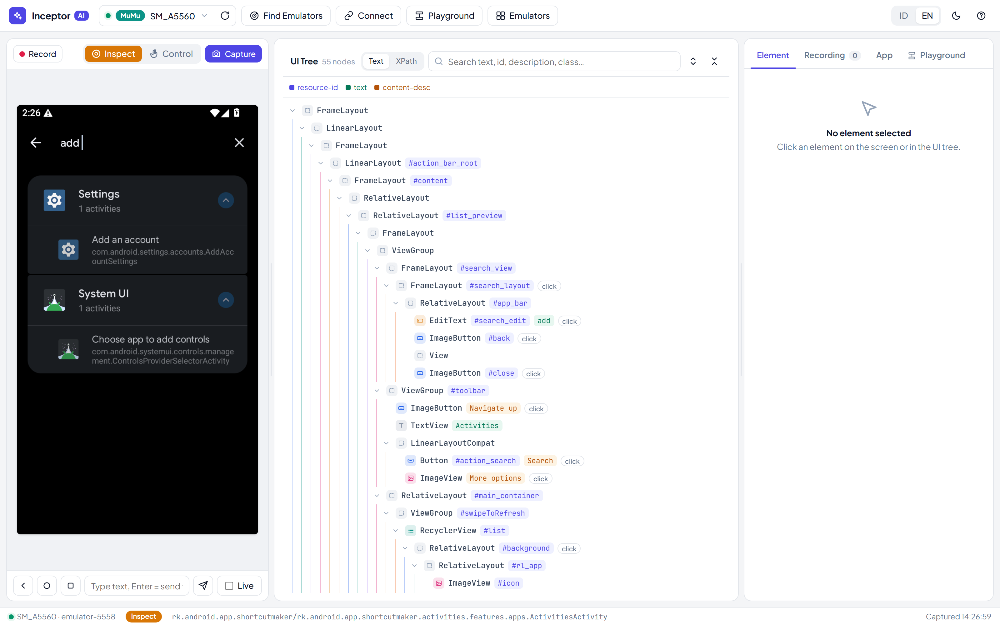
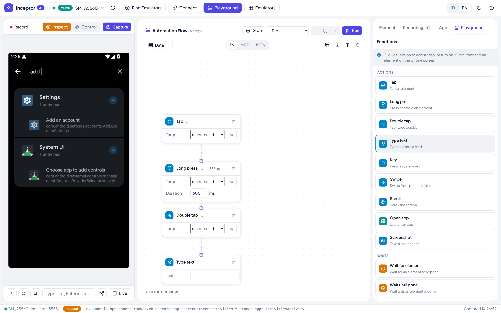
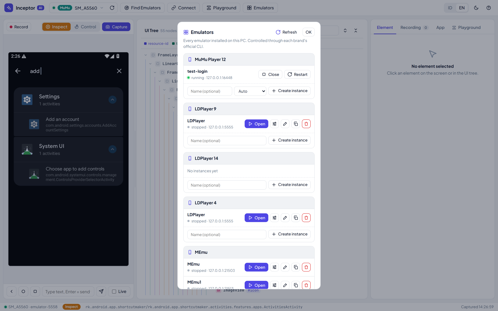
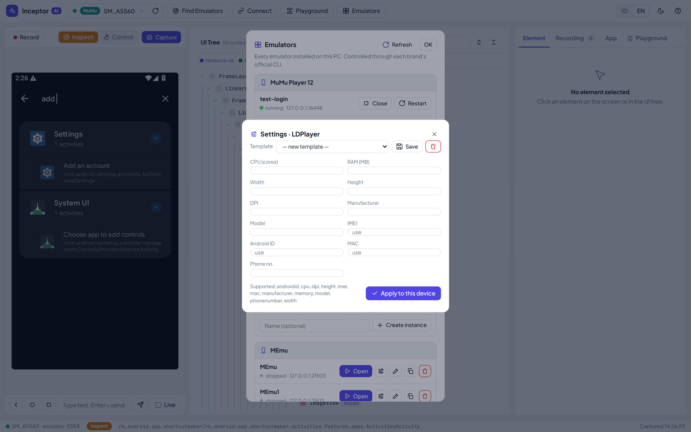
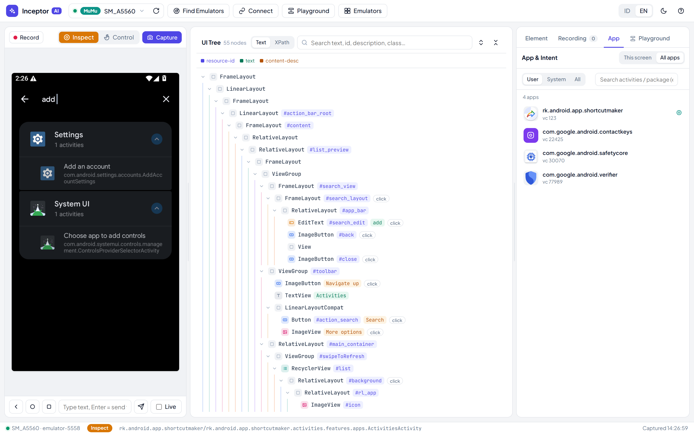
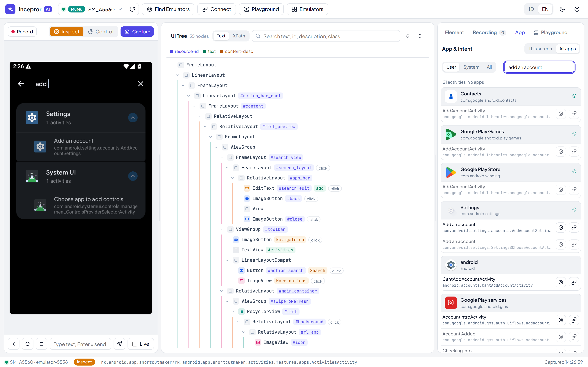

# Inceptor AI

A local, AI-first Android inspector & automation tool. See any Android emulator or phone over ADB, read its UI tree, drive it with durable selectors, build no-code automation flows on an n8n-style canvas, browse every installed app and activity, and manage whole emulator instances across brands — from a clean web UI **and** from an MCP server so an AI agent can do all of it in plain language.

Built on Python stdlib + `adb`. No framework, no build step — one `server.py`, plus `index.html` / `style.css` / `app.js`.


## Screenshots

**Inspector** — phone mirror, UI tree with graded selectors


**Playground** — n8n-style automation canvas


**Emulator Manager** — create / open / close / restart / delete across brands, with Android-version picker


**Device-settings template** — CPU, RAM, resolution and fingerprint per instance


**App & activity browser** — every installed app with icons


**Cross-app activity search** — find any activity by name or label, grouped by app (Shortcut-Maker style)


## Features

- **UI inspector** — screenshot + live MJPEG stream (~5 fps), accessibility tree with element-kind badges, click an element to grab a graded selector (resource-id / text / desc / XPath), live XPath tester.
- **Recorder** — record coordinate-free flows; export to uiautomator2 Python, MCP calls, or XPath.
- **Playground** — n8n-style free canvas: drag/pan/zoom nodes, auto-routed connectors, grab steps straight off the phone screen. Actions (tap, long-press, double-tap, type, key, swipe, scroll, open app, screenshot), waits (wait for / until gone / delay), logic (if / repeat / comment), and a **data loop** (`{{col}}` variables over a table of rows). Exports to Python / MCP / JSON.
- **App & activity browser** — every package and **every** activity from the APK (via androguard), exported/launcher flags, deep links, permissions; launch any activity, make a Windows `.lnk` shortcut, enable/disable/uninstall/backup. **Cross-app activity search** (Shortcut-Maker style): type "add an account" and it finds `Settings · AddAccountSettings` across all apps, grouped by app, each openable.
- **Emulator Manager** — create, open, close, restart, delete, rename, clone instances across **MuMu, LDPlayer (9/14/4), MEmu, Nox, BlueStacks** via each vendor's official CLI, with an **Android-version picker** on create and a **device-settings template** (CPU, RAM, resolution, manufacturer, model, IMEI, Android ID, MAC, phone number) for multi-account isolation.
- **MCP server** — 20 tools so an AI agent can see the screen, read the UI tree, act with selectors, browse apps, and manage emulators in natural language.

## Requirements

- Python 3.10+
- `adb` on `PATH` (Android platform-tools)
- `androguard`, `Pillow` for the app/activity browser and icons: `pip install androguard pillow`
- For the MCP server: `pip install "mcp[cli]" lxml pillow`
- Windows is the primary target (emulator CLIs, shortcuts). The inspector/Playground work cross-platform; the Emulator Manager calls Windows emulator binaries.

## Quick start — web inspector

```bash
python server.py
```

Open http://127.0.0.1:8765. With no device online you get a full setup guide that auto-scans every 5s; the first device found opens the workspace. Then: **Find Emulators** → **Capture** → click an element → copy its selector.

## MCP setup (for an AI agent)

Register the MCP server once (user scope) so Claude can drive the device:

```bash
claude mcp add android-inceptor -- python /absolute/path/to/mcp_server.py
```

Or add it to your MCP client config:

```json
{
  "mcpServers": {
    "android-inceptor": {
      "command": "python",
      "args": ["/absolute/path/to/mcp_server.py"]
    }
  }
}
```

**Tools:** `devices` · `use_device` · `connect` · `screenshot` · `ui_tree` · `find` · `tap` · `swipe` · `scroll` · `input_text` · `press_key` · `wait_for` · `app` · `apps` · `activities` · `start_activity` · `app_manage` · `shell` · `emulator` · `emulator_config`.

Typical loop: `devices()` → (if >1 online) `use_device(serial)` → `ui_tree()` → act with a selector (`tap(resource_id=...)`) → `wait_for(...)` the next screen → repeat.

### Skill (Claude Code / Claude Desktop)

A ready skill lives in [`skill/SKILL.md`](skill/SKILL.md). Install it so the agent knows when and how to use the tools:

```bash
mkdir -p ~/.claude/skills/android-inceptor
cp skill/SKILL.md ~/.claude/skills/android-inceptor/SKILL.md
```

## Emulator Manager

Header **Emulators** button → a panel listing every installed brand and its instances with Open / Close / Restart, ⚙ settings, ✎ rename, ⎘ clone, Delete (two-click confirm), and a Create row with an Android-version picker.

| Brand | Lifecycle | Create version | Device settings |
|------|-----------|----------------|-----------------|
| MuMu 12 | full | `auto / 12 / 15` | all except Android ID & MAC |
| LDPlayer 9 / 14 / 4 | full | fixed per install | all fields |
| MEmu | full | `44 / 51 / 71 / 76 / 90 / 96 / 120` | all fields |
| Nox | full (list needs Nox running) | `4 / 5 / 7` | not via CLI |
| BlueStacks 5 | open / close / restart only | no CLI | not via CLI |

From the AI:

```
emulator(action="list")
emulator(action="create", brand="mumu", android_version="12")
emulator(action="launch", brand="ld9", index="0")
emulator_config(brand="ld9", index="0", width=540, height=960, dpi=240, imei="auto", model="SM-G991B")
```

Device settings usually need the instance **stopped**; restart it after applying. `imei` / `androidid` / `mac` accept `"auto"` (LD/MEmu) to randomize — handy for multi-account fingerprint isolation.

## Notes

- Emulators ship their own `adb` that can clash with platform-tools — stick to one `adb`.
- Port clashes: BlueStacks binds `127.0.0.1:5555`; LDPlayer 9 binds `0.0.0.0:5555` (reachable via any non-loopback local IP — scan handles this). LDPlayer's `0.0.0.0` bind exposes ADB to the LAN with no auth — trusted networks only.
- `uiautomator dump` fails on screens that never go idle (video, heavy animation) — fall back to `screenshot()` + coordinates.
- Automating real accounts on platforms (Google / Shopee / TikTok / WhatsApp) risks rate-limits and bans — pace actions like a human.

## License

MIT — see [LICENSE](LICENSE).
