<div align="center">

# ✨ Inceptor AI

### 🤖 See & drive any Android emulator or phone over ADB — for humans *and* AI agents

Inspect the UI tree, grab durable selectors, build no-code automation flows on an n8n-style canvas, browse every app & activity, and manage whole emulator instances across brands — from a clean web UI **and** from a built-in MCP server.

[](#-requirements)
[](#)
[](#-mcp-setup-for-an-ai-agent)
[](#-emulator-manager)
[](LICENSE)

</div>

---

## 📖 About

**Inceptor AI** is a single-file Python server (+ a vanilla HTML/CSS/JS front-end, no build step) that turns any Android emulator or USB/Wi-Fi phone into something you can **see, understand, and automate** — by hand or by an AI agent.

- 🔍 **Inspect** — mirror the screen, read the accessibility tree, and get *graded* selectors (Best → Fragile)
- 🧩 **Automate** — snap steps together on a free canvas, loop over data rows, export to Python / MCP / JSON
- 📦 **Browse** — every installed app and **every** activity (via androguard), searchable across all apps
- 🎛️ **Manage** — create / open / close / restart / delete emulator instances across 5 brands, with Android-version & device-fingerprint templates
- 🧠 **MCP-native** — 21 tools so Claude (or any MCP client) can do all of the above in plain language

> Built for RE / automation / multi-account work on **your own** devices and lab. Everything runs locally; nothing phones home.

---

## 🎬 Demos

| Cross-app activity search | Building an automation flow |
|:---:|:---:|
| 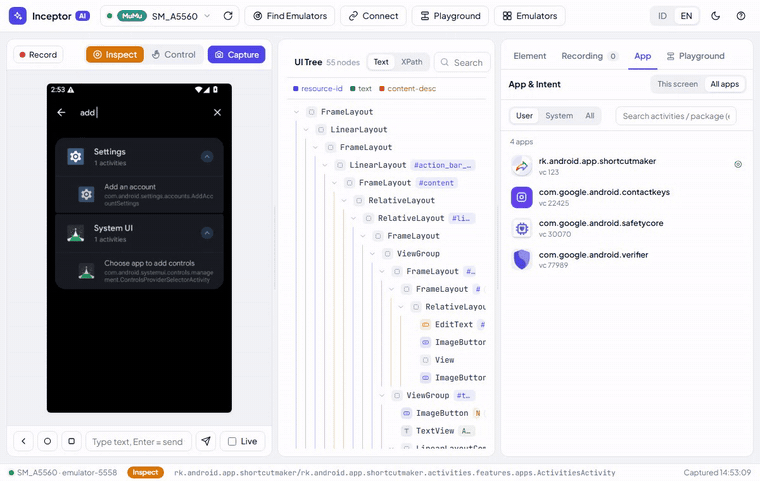 | 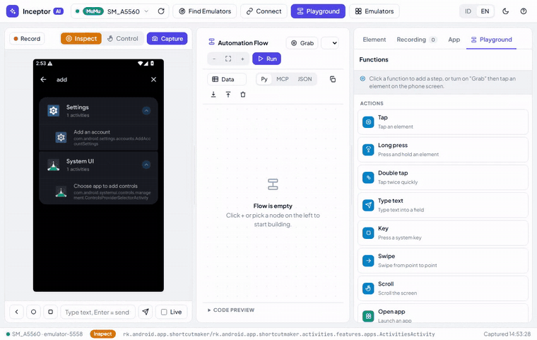 |
| *Type "add an account" → finds `Settings · AddAccountSettings` across every app, grouped & openable* | *Click functions to snap steps onto the canvas* |

<div align="center">

**Emulator manager + device-settings template**

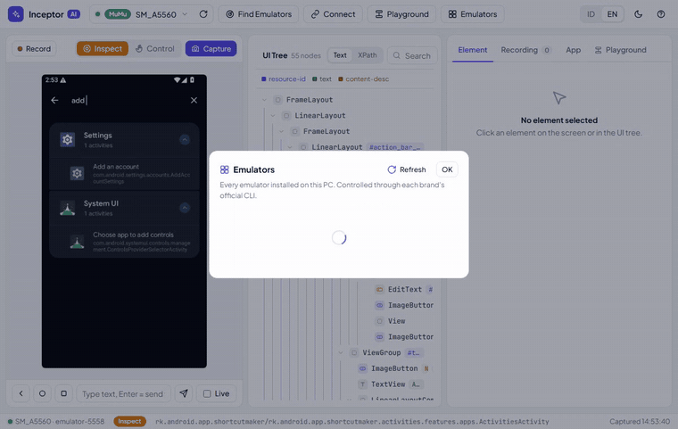

</div>

---

## 🖼️ Gallery

<table>
<tr>
<td width="50%">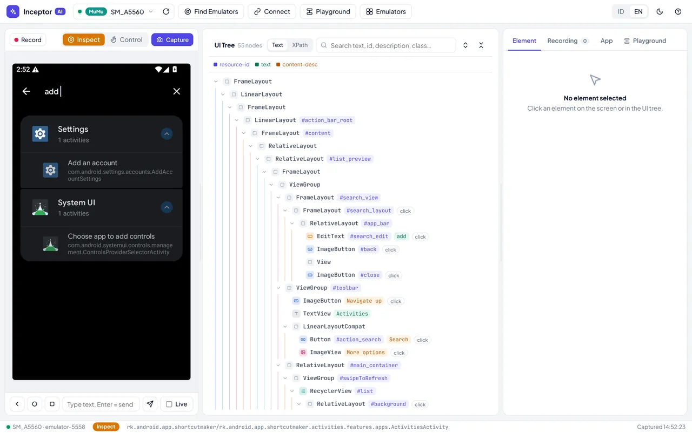<br><sub><b>🔍 Inspector</b> — tree + graded selectors</sub></td>
<td width="50%">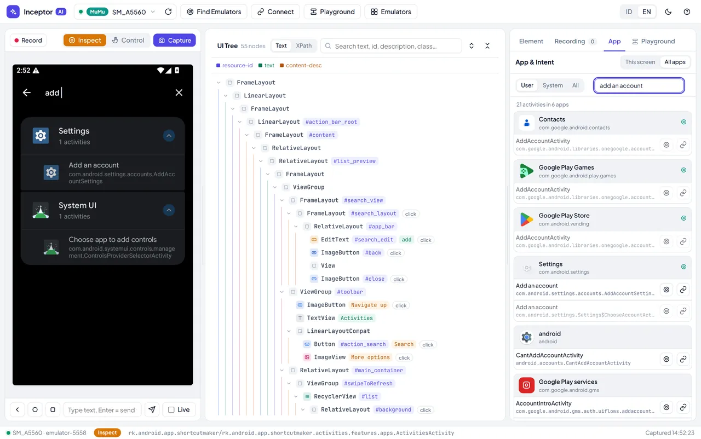<br><sub><b>🧭 Activity search</b> — across all apps (Shortcut-Maker style)</sub></td>
</tr>
<tr>
<td width="50%">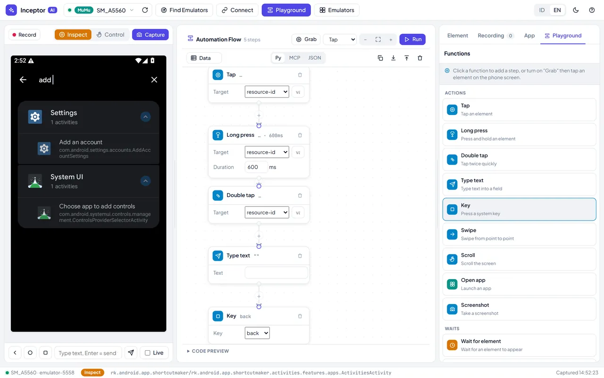<br><sub><b>🧩 Playground</b> — n8n-style automation canvas</sub></td>
<td width="50%">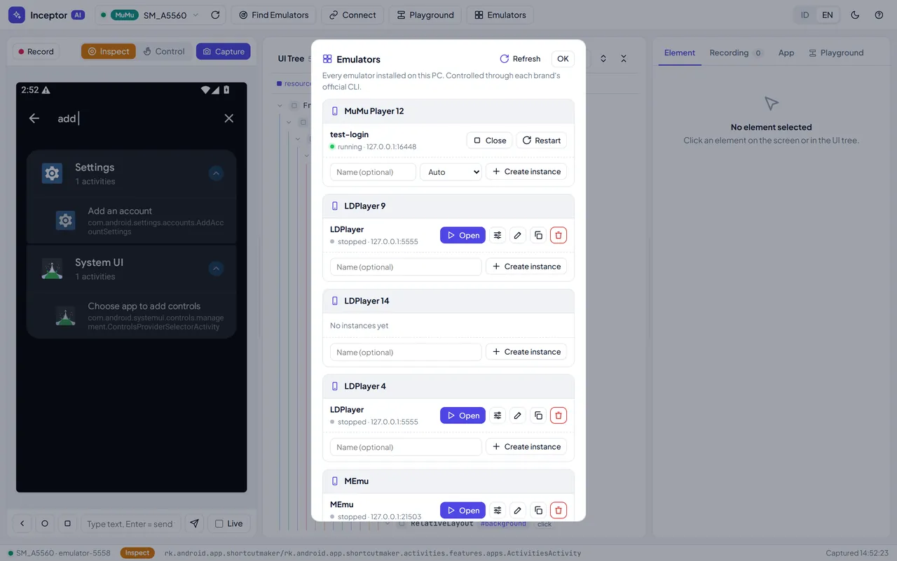<br><sub><b>🎛️ Emulator Manager</b> — all brands + version picker</sub></td>
</tr>
<tr>
<td width="50%">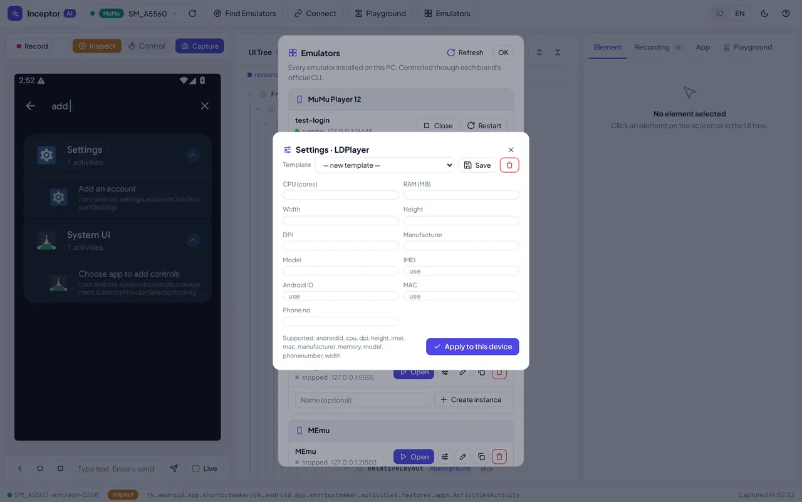<br><sub><b>⚙️ Device template</b> — CPU/RAM/res + fingerprint</sub></td>
<td width="50%">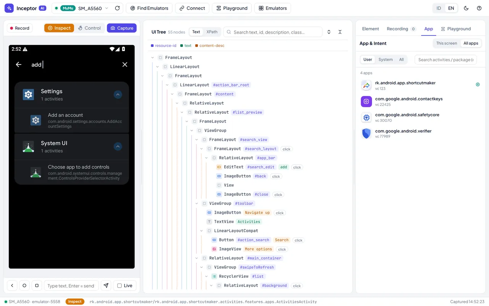<br><sub><b>📦 App browser</b> — every app with real icons</sub></td>
</tr>
<tr>
<td width="50%">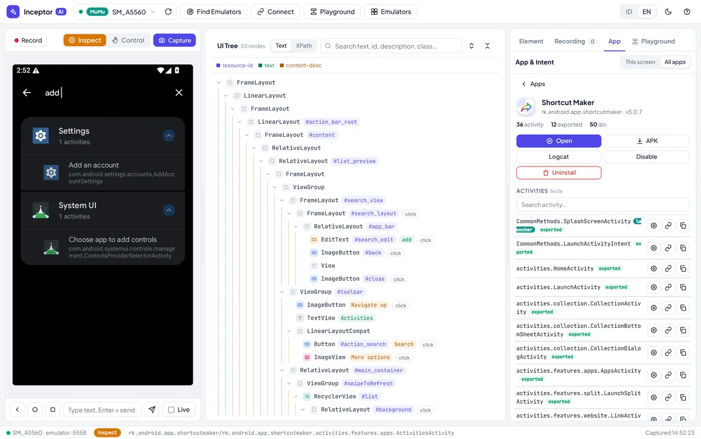<br><sub><b>📑 App detail</b> — activities, deep links, permissions</sub></td>
<td width="50%">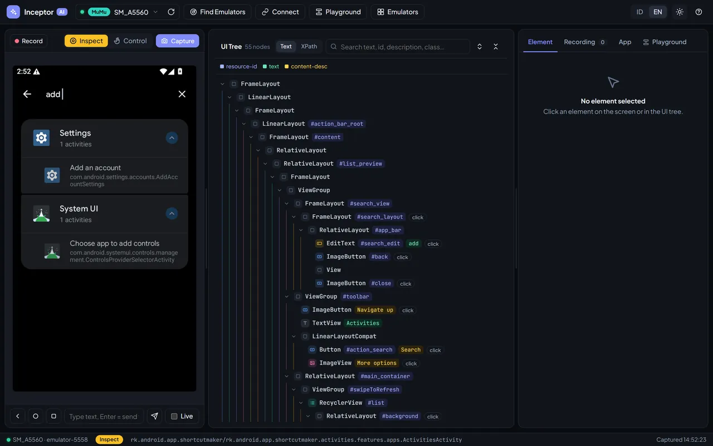<br><sub><b>🌙 Dark mode</b> — because of course</sub></td>
</tr>
</table>

---

## ⭐ Features

- 🔍 **UI inspector** — screenshot + live MJPEG stream (~5 fps), accessibility tree with element-kind badges, click an element for a graded selector (resource-id / text / desc / XPath), live XPath tester.
- ⏺️ **Recorder** — record coordinate-free flows; export to uiautomator2 Python, MCP calls, or XPath.
- 🧩 **Playground** — n8n-style free canvas: drag / pan / zoom nodes, **auto-arrange** + restore-layout, auto-routed connectors, grab steps straight off the phone. Actions (tap, long-press, double-tap, type, key, swipe, scroll, open app, screenshot), waits (wait for / until gone / delay), logic (if / repeat / comment), and a **data loop** (`{{col}}` variables over rows, filled in the Data tab). The **Open app** step has a searchable **activity picker** (per-app list + cross-app search). A persistent **run log** shows each step ✓/✗ with the error and the XPath that failed. Copy as Python / MCP / JSON; **download always saves JSON** (flow + data) so saved & shared flows re-import cleanly.
- 🔄 **Self-update** — on launch the UI checks GitHub and, when the repo is ahead, shows an **"update available"** banner with a one-click `git pull` (and a link to the diff).
- 📦 **App & activity browser** — every package and **every** activity from the APK (androguard), exported/launcher flags, deep links, permissions; launch any activity, make a Windows `.lnk` shortcut, enable/disable/uninstall/backup.
- 🧭 **Cross-app activity search** — type `add an account` and find `Settings · AddAccountSettings` across all apps, grouped by app, each openable (Shortcut-Maker style).
- 🎛️ **Emulator Manager** — create / open / close / restart / delete / rename / clone across **MuMu, LDPlayer (9/14/4), MEmu, Nox, BlueStacks** via each vendor's CLI, with an **Android-version picker** on create and a **device-settings template** (CPU, RAM, resolution, manufacturer, model, IMEI, Android ID, MAC, phone number) for multi-account isolation.
- ⌨️ **Command palette** (`Ctrl K`) — fuzzy-search every action, device, installed app and activity; recent items first.
- 🖱️ **Remote-control feel** — in Control mode the keyboard types straight to the device (Enter/Backspace/Tab/arrows/Esc=Back) and the mouse wheel scrolls; right-click any element (screen or tree) for copy selector / tap / long-press / add to Playground.
- 📜 **Logcat viewer** — live tail with "this app only", min level, text filter, pause/clear/copy.
- 🎥 **Screen recording** (MP4, up to 3 min) and one-click **PNG screenshot** download.
- 📱 **Device info** — model, Android/SDK, ABI, screen, battery, IP, uptime, storage, RAM.
- 🗂️ **Playground flow library** — many named flows (new / rename / duplicate / delete), real **undo/redo** (`Ctrl Z` / `Ctrl Shift Z`), disable a step, run one step / run from here, Delete & `Ctrl D` shortcuts, and **Steps → Playground** to turn a recording into a flow.
- 🧠 **MCP server** — 21 tools so an AI agent can see the screen, read the tree, act with selectors, browse apps, and manage emulators in natural language.

---

## 🧰 Requirements

- 🐍 Python 3.10+
- 📱 `adb` on `PATH` (Android platform-tools)
- 📦 `pip install androguard pillow` (app/activity browser + icons)
- 🧠 `pip install "mcp[cli]" lxml pillow` (MCP server)
- 🪟 Windows is the primary target (emulator CLIs & shortcuts). Inspector/Playground are cross-platform; the Emulator Manager calls Windows emulator binaries.

## 🚀 Quick start — web inspector

```bash
python server.py
```

Open **http://127.0.0.1:8765**. With no device online you get a full setup guide that auto-scans every 5s; the first device found opens the workspace. Then: **Find Emulators → Capture → click an element → copy its selector**.

## 🧠 MCP setup (for an AI agent)

```bash
claude mcp add android-inceptor -- python /absolute/path/to/mcp_server.py
```

Or add it to your MCP client config:

```json
{
  "mcpServers": {
    "android-inceptor": {
      "command": "python",
      "args": ["/absolute/path/to/mcp_server.py"]
    }
  }
}
```

**Tools:** `devices` · `use_device` · `connect` · `screenshot` · `ui_tree` · `find` · `tap` · `swipe` · `scroll` · `input_text` · `press_key` · `wait_for` · `app` · `apps` · `activities` · `start_activity` · `app_manage` · `shell` · `emulator` · `emulator_config`

Typical loop: `devices()` → (if >1 online) `use_device(serial)` → `ui_tree()` → act with a selector (`tap(resource_id=...)`) → `wait_for(...)` the next screen → repeat.

### 🧩 Skill (Claude Code / Claude Desktop)

A ready skill lives in [`skill/SKILL.md`](skill/SKILL.md):

```bash
mkdir -p ~/.claude/skills/android-inceptor
cp skill/SKILL.md ~/.claude/skills/android-inceptor/SKILL.md
```

## 🎛️ Emulator Manager

Header **Emulators** button → a panel listing every installed brand and its instances with Open / Close / Restart, ⚙️ settings, ✎ rename, ⎘ clone, Delete (two-click confirm), and a Create row with an Android-version picker.

| Brand | Lifecycle | Create version | Device settings |
|------|-----------|----------------|-----------------|
| 🟢 MuMu 12 | full | `auto / 12 / 15` | all except Android ID & MAC |
| 🔵 LDPlayer 9 / 14 / 4 | full | fixed per install | all fields |
| 🟣 MEmu | full | `44 / 51 / 71 / 76 / 90 / 96 / 120` | all fields |
| 🟠 Nox | full (list needs Nox running) | `4 / 5 / 7` | not via CLI |
| 🔷 BlueStacks 5 | open / close / restart only | no CLI | not via CLI |

From the AI:

```python
emulator(action="list")
emulator(action="create", brand="mumu", android_version="12")
emulator(action="launch", brand="ld9", index="0")
emulator_config(brand="ld9", index="0", width=540, height=960, dpi=240, imei="auto", model="SM-G991B")
```

Device settings usually need the instance **stopped**; restart it after applying. `imei` / `androidid` / `mac` accept `"auto"` (LD/MEmu) to randomize — handy for multi-account fingerprint isolation.

## ⚠️ Notes

- Emulators ship their own `adb` that can clash with platform-tools — stick to one `adb`.
- Port clashes: BlueStacks binds `127.0.0.1:5555`; LDPlayer 9 binds `0.0.0.0:5555` (reachable via any non-loopback local IP — scan handles this). LDPlayer's `0.0.0.0` bind exposes ADB to the LAN with no auth — trusted networks only.
- `uiautomator dump` can fail on screens that never go idle (video, WebViews, heavy animation). The run engine now retries with back-off and keeps polling within each step's timeout instead of failing instantly; for truly never-idle screens, fall back to `screenshot()` + coordinates.
- Taps auto-dismiss the soft keyboard first for non-text targets — the keyboard isn't in the UI dump, so bottom buttons (NEXT / Submit) could otherwise be tapped "through" it, causing flaky runs.
- 🔒 The server only answers requests from its own page on `127.0.0.1`/`localhost` (Host, Origin and `Sec-Fetch-Site` are checked), so random websites can't drive your device. State-changing routes (uninstall, emulator actions, update, logcat clear, screen record) also require the header `X-Inceptor: 1` — add it when scripting them with curl.
- Automating real accounts on platforms (Google / Shopee / TikTok / WhatsApp) risks rate-limits and bans — pace actions like a human.

## 📄 License

MIT — see [LICENSE](LICENSE).
